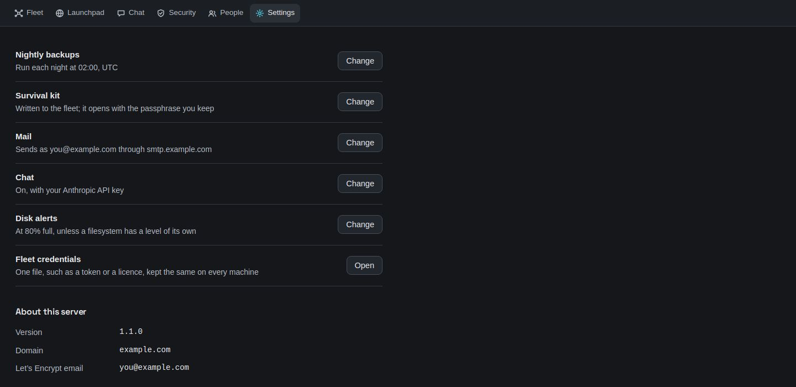

# Advanced topics

Back to [README](../README.md).

Configuration and workflows beyond the basic Quick Start. If you're just getting started, the README is enough.



---

## The installer

`install.sh` installs Vaier and updates it by hand. It runs only on x86-64 (amd64) machines. It always fetches the runtime files for one ref of the repository (pin it with `VAIER_REF`: a branch, tag or commit — a commit or a `v` tag also pins Vaier's image to that build, a branch follows `latest`), creates `.env` at mode `600` if there is none, and adds any auto-generated secret `.env` lacks. It never changes a value you set.

**At a terminal, it finishes the job** — including `curl … | bash`:

- **Asks three questions on a fresh install**: your **domain**, your **email** (Let's Encrypt's contact and the first-run sign-in account — see [AUTH](AUTH.md#the-first-run-password-before-you-have-registered-anything)), and your **time zone** for schedules. They go into `.env` as `VAIER_DOMAIN`, `ACME_EMAIL` and `VAIER_TZ`.
- **Checks DNS.** If `vaier.<domain>` doesn't resolve yet, it prints the exact wildcard record to make. Starting now is fine — Vaier waits up to five minutes for the record before asking for certificates ([Wildcard DNS](NETWORKING.md#wildcard-dns)). If it points at another server, fix the record before starting: Let's Encrypt would ask that server, and refuses for an hour after a few failures.
- **Offers to install Docker** when it is missing.
- **Checks what would stop the start**: a Docker Compose older than v2.23, or TCP 80, TCP 443 or UDP 51820 already taken (it names the program holding the port). It says so instead of offering to start.
- **Offers to start Vaier** and prints the first-run sign-in: URL, email and password.

Sign-in providers and mail are set later in the console — Google or GitHub under **People → Sign-in providers** ([AUTH](AUTH.md#registering-google-or-github)), mail under **Settings**.

**Re-run on an existing install**, it asks nothing and offers **Bring Vaier up to date now?** Answer no and it only refreshes the files; `docker compose pull && docker compose up -d` then updates by hand, followed by `docker compose up -d --no-deps --force-recreate vaier-shell` if you run the shell gateway.

The commands it prints carry `sudo` when your user is not in the `docker` group.

**Without a terminal** (or with `VAIER_NONINTERACTIVE=1`) it only does the groundwork and prints the next steps. **Settings → Update Vaier** runs it this way ([Monitoring](MONITORING.md#updating-vaier-itself)).

**Docker Compose v2.23 or newer** is required. The installer's own Docker install is always new enough; Ubuntu's and Debian's `docker.io` package often is not.

**`required variable VAIER_DOMAIN is missing a value`** means `.env` has no domain or email yet: fill in `VAIER_DOMAIN` and `ACME_EMAIL`.

**`required variable … is missing a value`** from `docker compose up -d` means your `.env` predates a secret a newer release generates. Re-run the installer to add it; a running stack keeps running meanwhile.

---

## Removing Vaier

`uninstall.sh` removes the stack's containers, networks and images, the routes Vaier added on the host, the install folder (unless it is your home folder or a git checkout, which it leaves for you), and Vaier's files in your home folder (plus the backup client's sudoers rule and the SSH keys Vaier made, if present). It finds the stack through Docker's own labels, so it works after the folder is gone. It asks before removing anything; `VAIER_UNINSTALL_DRY_RUN=1` only prints what it would do. Docker itself, your DNS record and firewall rules are left to you.

---

## Environment variables

| Variable | Required | Description |
|----------|----------|-------------|
| `VAIER_DOMAIN` | Yes | Base domain (e.g. `yourdomain.com`) |
| `ACME_EMAIL` | Yes | Let's Encrypt email; first-run account if `VAIER_ADMIN_EMAIL` is blank |
| `VAIER_TZ` | No | Time zone for schedules, e.g. `Europe/Berlin` (default `UTC`) |
| `VAIER_OIDC_GOOGLE_CLIENT_ID` | Optional | Google OAuth client id |
| `VAIER_OIDC_GOOGLE_CLIENT_SECRET` | Optional | Google OAuth client secret |
| `VAIER_OIDC_GITHUB_CLIENT_ID` | Optional | GitHub OAuth App client id |
| `VAIER_OIDC_GITHUB_CLIENT_SECRET` | Optional | GitHub OAuth App client secret |
| `VAIER_ADMIN_EMAIL` | No | First admin; restored to admin whenever none remains |
| `VAIER_OAUTH2_COOKIE_SECRET` | Auto | oauth2-proxy session cookie secret |
| `VAIER_DEX_CLIENT_SECRET` | Auto | oauth2-proxy↔Dex shared secret |
| `VAIER_CROWDSEC_BOUNCER_KEY` | Auto | CrowdSec bouncer API key |
| `VAIER_VAULT_KEY` | No | The survival kit's config key, for a recovery whose `vaier/config/vault.key` is missing |
| `VAIER_PUBLIC_HOST` | No | Public hostname, when not on EC2 |
| `VAIER_PUBLIC_IP` | No | Public IPv4, what `*.<domain>` should resolve to; the installer fills it in |
| `VAIER_SERVER_LAN_CIDR` | No | The server's own LAN, for LAN servers with no relay peer (see below) |

"Auto" secrets are generated into `.env` for you. A provider is offered only when both its client id and secret are set; its redirect URI is `https://dex.<domain>/callback`. With no provider, Vaier opens the [first-run door](AUTH.md#the-first-run-password-before-you-have-registered-anything) instead.

On EC2 the public address and subnet are read from instance metadata. The installer also writes `VAIER_PUBLIC_IP` when it can find the address. Without it, off EC2, Vaier can check that `*.<domain>` resolves but not that it resolves *here*, and **Needs you** asks you to set it — not to change DNS. If the server's address changes, change `VAIER_PUBLIC_IP` with it.

Vaier answers only what comes through Traefik, where sign-in is checked. Another container on its network, or the host, calling `vaier:8080` directly gets `403`. To ask it something from the server itself, run the request inside its container: `docker exec vaier curl -s localhost:8080/<path>`.

---

## Secrets on disk

Vaier writes its secret files at mode `600`. Keep `.env` at mode `600` too, and the folders closed to other users:

```bash
chmod 600 .env
chmod -R go-rwx vaier/ oauth2/ wireguard/ traefik/
```

| File | Contents |
|------|----------|
| `vaier/config/vault.key` | The key that unlocks every stored password and passphrase. Lose it and they are unreadable, unless a written survival kit gives it back; a copy of it together with the config folder exposes them all |
| `vaier/config/vaier-config.yml` | Domain, SMTP settings **and the SMTP password** |
| `vaier/config/host-credentials.yml` | How Vaier signs in to each machine: SSH passwords and keys |
| `vaier/config/service-credentials.yml` | The sign-ins Vaier stores for published services |
| `vaier/config/first-run-password` | The first-run sign-in's email and password |
| `vaier/config/access.yml` | Access store — the known identities, their roles and access groups |
| `oauth2/config/client-secret` | The secret oauth2-proxy and Dex share |

---

## Publishing a service from a LAN server (Docker optional)

A *LAN server* is any machine that isn't itself a VPN peer — a NAS, a printer, IPMI, an extra Docker host — on a relay peer's LAN or **in the Vaier server's own subnet** (an AWS VPC, say). Register it once, then publish its services.

1. Make sure its address is covered by something Vaier routes to:
   - **Behind a relay peer:** Vaier offers the peer's network on that machine's page — "Reach the rest of Cabin's home network?" — usually one click on **Reach it**. For a network it can't see, set it under **The network behind this machine** in the machine's edit form.
   - **In the Vaier server's own subnet:** on EC2 the subnet is auto-detected. To cover the whole VPC (e.g. `172.31.0.0/16`), or off EC2, set `VAIER_SERVER_LAN_CIDR`. Allow inbound from the Vaier server in the machine's security group or firewall.
2. Add it: **Add a machine** → *Something already on one of my networks* (or **Add by address instead**), with Docker on or off.
3. Run its single-use **setup link** with `sudo` on the machine. With Docker on, it opens the Docker API on TCP 2375 to the fleet only (no TLS), and it adds the routes back to the rest of your network.
4. With Docker on, its containers appear under **Ready to publish**. For a native service, open the machine's services and use **Publish a service by hand**: enter port, subdomain and protocol. No DNS step.

> **Limitation:** the "Vaier server's own subnet" path doesn't yet let *split-tunnel server peers* reach that subnet. Full-tunnel mobile and Windows clients already can.
