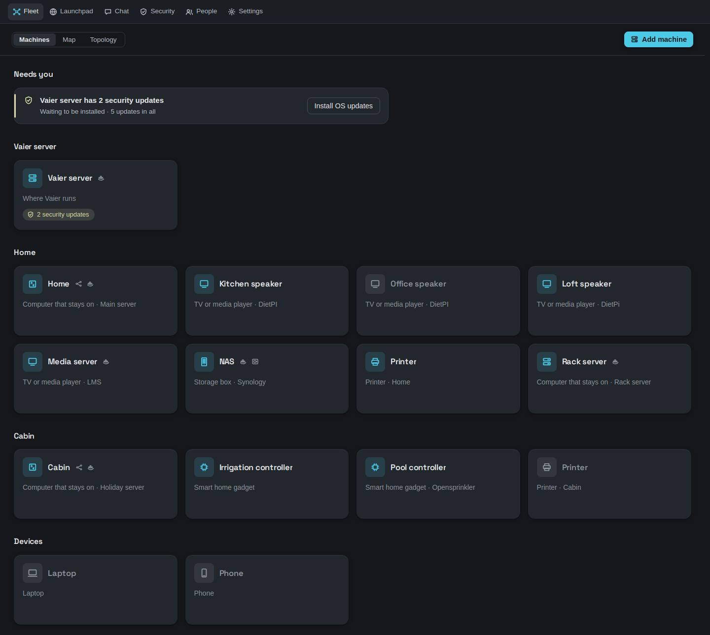
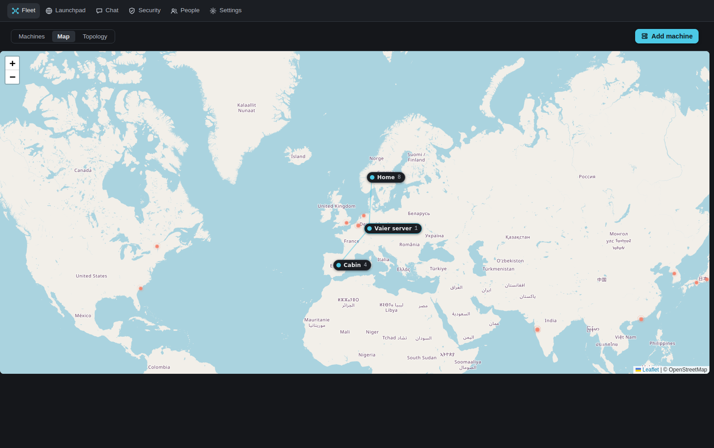

# Explorer

Back to [README](../README.md).

The Explorer, at `/explorer.html`, is one address space for the whole fleet. Every entry has its own link, and the address bar says where you are.

---

## The front door and the navigation bar

Your Vaier's address takes an admin to the **Fleet** and everyone else to the **Launchpad**, the page of tiles at `/launchpad.html`.

- The **navigation bar** holds **Fleet**, **Launchpad**, **Chat** (while an Anthropic key is stored), **Security**, **People** and **Settings**, with the current one marked. It sits in the topbar, as icons only on a phone. Admins see it on the Launchpad too; nobody else does.
- Your avatar, at the topbar's right end, holds **Concepts** (the in-app glossary) and **Sign out**.
- **Settings** holds what you set up once: backup hour, survival kit, mail, Chat's key, default disk threshold and **Fleet credentials**. Each is one line with **Change**. Trouble is never shown here; it goes in **Needs you**.

---

## Needs you

The top of the **Fleet** answers "is anything wrong?". **Needs you** is one list: a plain sentence per problem, its evidence, and at most one button to the fix. Most urgent first:

- someone waiting to join (**Add**);
- what the [pre-flight](MONITORING.md#pre-flight) found wrong;
- an alert mail that did not go out (**Check mail**);
- a Vaier update that failed or rolled back;
- a server not answering (**I switched it off**, see below) — phones and laptops that are away are never listed;
- a server that hasn't connected yet, because its setup hasn't run on it (**Show its setup**, or **Update its setup** where Vaier can sign in);
- a backup that went wrong (**Open its backup**, **Get this machine ready**, or **Back up as root**);
- a disk past or near its threshold (**Open its disk**);
- security updates waiting (**Install OS updates**);
- a published website nothing answers behind, its machine up (**Unpublish**);
- [reverse proxy config](MONITORING.md#reverse-proxy-audit) entries no route can reach (**See which**);
- up to three suggestions of what to do next;
- a newer Vaier (**Update Vaier**), and newer container images (**See them**).

A button about a setting, such as **Set up mail** or **Check mail**, opens Settings at that item, unfolded. **Update Vaier** asks once, then updates. A row goes the moment its problem clears. **When nothing needs you, the list shows nothing and takes no room.**

Machines are **grouped by site**: the Vaier server's site first, then each house with a server peer, then phones and laptops under **Devices**. A machine never moves when trouble comes or goes; its card wears a short mark instead ("Backup failed"). A machine's own page opens on its own Needs you rows.

### Switched off on purpose

Some machines are off because you turned them off. Tap **I switched it off** on its "not answering" row and Vaier stops treating that as trouble: its card turns grey, nothing is mailed, and its nightly backup is skipped, not failed.

Its page says "Switched off on purpose since 14 Sep", with **It's back on**. You rarely need that button: the mark clears itself the first time Vaier reaches the machine again. Phones, laptops and the Vaier server are never offered it.

---

## The address space

A machine's page shows its name (plus one line when it is not well), its Needs you rows, and then its **doors**. A machine only gets the doors Vaier can actually reach:

| Door | Entry | Its fact |
|------|-------|----------|
| **Shell** | — (opens a window) | "Opens where you left off" |
| **Files** | `files` | "Browse its files" |
| **Apps** | `containers` | "8 apps · 1 update" |
| **Websites** | `services` | "7 websites · 1 ready to publish" |
| **Storage** | `disk` | "60% full" |
| **Backups** | `backup` | "Backed up last night", "Paused — switched off" |

A door is greyed, with the reason on hover, when Vaier can't sign in or the machine isn't answering. If a read fails, the page says why in plain words, with **Change sign-in** when the machine turned Vaier's sign-in down. Turning on **Let Vaier sign in to this machine** asks for the sign-in straight away. Below the doors come **What to do next** (nudges for this machine) and, when updates wait, a line such as "4 updates waiting · none urgent" with **Install OS updates**.

Everything else sits in one closed fold, **Sign-in, details and removal**: who Vaier signs in as (**Change**, and **Stop Vaier signing in here**, which asks first — it also stops backups, disk watching, updates and files there), addresses, **Edit details**, the machine's setup (**Update its setup** where Vaier can sign in to it, otherwise **Download its setup again**), and last a red fold holding **Give it new keys** and **Remove machine**, each confirmed by typing the machine's name.

**Every location has its own link**, including the archive you're viewing, so reload, Back and bookmarks all work.

### One pane, at every width

There is no tree column. Drill in through cards and listings; come back through the address bar's crumbs. The Fleet's head carries one switch, **Machines · Map · Topology**, and **Add machine**.

A healthy **machine card** says almost nothing: what the machine is and your description of it ("Storage box · Synology"), and small glyphs for relay, Docker or backup server. **Marks** appear only for trouble — a failed backup, a filling disk, **Claude signed out**, containers wanting a newer image. A machine that is down reddens its whole card.

A machine Vaier hasn't read yet shows no disk mark. That is not a claim the disk has room.

People, Security, Chat and Settings live in the **navigation bar**, not in the fleet. See [Access management](AUTH.md#access-management) for People.

### Files

Folders are read over SFTP as you open them, using the machine's stored credential. A folder that can't be read shows the server's own message, never an empty listing. A machine whose SSH has no SFTP (DietPi's Dropbear) needs `openssh-sftp-server` or OpenSSH. Paths are always the machine's own, even on a NAS that jails SFTP into `/volume1`.

### Containers and published services

**Apps** lists containers with a port, published or only exposed, running or stopped. A stopped one reads **DOWN**; one Vaier saw running and now finds stopped reads **gone**.

Vaier cannot start, stop or read logs — use the shell. Its one action is **Update** on an out-of-date container started by compose: it pulls the new image, recreates the container and removes the old image. A container on a **moving tag** (a daily `latest`) is marked `moving` and never mailed about.

**Websites** lists published services. A route reads **Not answering** when its machine is out of reach or its own port turns Vaier away — say, the container behind it was removed. Unpublished containers appear under **Ready to publish**, and **Publish a service by hand** covers anything else. Opening a service gives **Open** and four blocks: **Who can open it**, **Sign people in for it**, **On the Launchpad**, and folded **Details**. To change its address, edit **Its address** under **Details** and press **Move**: every setting goes with it, the old address stops working at once, and the new one may show a browser warning for a minute until its certificate arrives. Vaier refuses an address another service holds, and won't move a signed-in service next to services that let in different groups. **Unpublish this service** comes last and leaves the container running. See [NETWORKING](NETWORKING.md).

### Disk

**Storage** lists every real filesystem with its usage and threshold. Stop watching one that is full by design, or give it its own threshold; one using the fleet's shows it greyed. A new volume is watched by default. See [MONITORING](MONITORING.md).

### The backup server's own entry

Pick the fleet's backup server with **Make this the fleet's backup server** on a machine's page. It then shows **Backups kept here**, one per machine; Vaier creates them, you never do. **Forget these backups** takes them off the list once no machine backs up there any more; no archive is erased and the survival kit keeps their passphrase. The manual tools (**Provision**, **Authorize a machine**, …) sit under a warning fold: they are for recovery. See [BACKUP](BACKUP.md).

### Selection, transfers and viewing files

**Tick files to build a Selection**; it survives moving between folders and machines. The bar above the listing carries every verb that applies.

- **View** images, PDFs, text and video in a new tab. HTML and SVG are download-only.
- **Download** a file, or a zip of a folder or several items. A zip holds no links, so each link inside the folder is listed in *Not included.txt*, with anything Vaier cannot read and anything that is not an ordinary file (a pipe or socket). A pipe or device on its own is refused rather than downloaded or viewed.
- **Transfer** a file or folder to another machine, with live progress. Links inside the folder arrive as links, pointing where they pointed. What Vaier cannot read, or a link it cannot make there, is left out, and the finished transfer says how many items it left out and names them. Something of the same name already there is never replaced without asking. The one exception is a restore: the past put back on its own path on its own machine goes ahead without asking; pasted anywhere else it asks like any copy.
- **Upload** by dropping files on the folder or with **Upload files**. Files only. An existing name is never replaced without asking.
- **Delete**, confirmed by typing the file's name (or, for several, how many). It cannot be undone. A folder holding something Vaier's sign-in may not remove is deleted only partway: the message says how many items were already gone, and the listing shows what is left.

**Every write goes to the present.** Copying *from* an archive and pasting back is how you restore. Verbs Vaier's sign-in can't perform are hidden; an ACL or read-only mount can still make the machine refuse.

### Browsing the past (the time rail)

A machine with backups grows a **time rail**: one stop per archive, newest nearest **Now**. Click a stop to see the files as they were. The past turns amber and offers no write verbs. Links read as they did in the backup; one that leads outside it says **Link, not backed up** and can't be opened, downloaded or restored, because borg never kept what it pointed at. Click **Now** to return. While that machine's backup is running, borg locks the repository and the past shows its error instead; try again when the run ends.

**When a machine dies, its past still opens.** If Vaier can't reach a machine, its time rail works as usual: another machine reads the backups for it, and the pane's head says *Read from ‹machine› while ‹machine› can't be reached*. Browse, view, download, or copy files and folders onto any machine, a replacement included; a paste onto another machine asks before replacing anything. A machine you removed from the fleet has no Files entry: open its backups under the backup server's entry and click an archive. Its past opens the same way, without a **Now**. This needs the survival kit to have been written (see [BACKUP](BACKUP.md#survival-kit)); until then the past says so.

### Marking what matters (backing up from the file view)

**Mark what matters and Vaier backs it up.** Tick files or folders and click **Back up**. Vaier sets up everything else, including the borg client on a machine's first back-up.

Entries then wear a **shield**: full when backed up, half when something inside is. **Stop backing up** really stops it. **Back up** appears only once the fleet has a backup server.

---

## Map

The **Map** draws one marker per **site**: the Vaier server and each fixed-line peer, placed by its internet address. LAN machines belong to their relay's site.

- A marker shows the site's machine count, or how many are down, in red.
- Each site's line to the Vaier server is dashed red when its tunnel is down.
- Click a site to list its machines.
- Blocked addresses show as red pings; see [Security](#security).

Phones and laptops are never placed, and Vaier keeps no record of where anyone has been.

---

## Topology

The **Topology** draws the fleet as a painted coast under the real sky. Hover anything for what it is; click a house or boat to open that machine.

- The **sea** is the internet; the **lighthouse** is the Vaier server, its beam your published services.
- A **village** is a peer that reaches a LAN; each LAN server is a house in it.
- A **wake** to the lighthouse is a tunnel.
- A **boat** is any other peer. Disconnected, it lies moored.
- A **pirate ship** is a blocked address. Click it to open [Security](#security).
- Each **window** is a website the machine publishes, lit while it answers and dark while it doesn't. A house that is down or away is dark throughout.
- A white **flag with a red cross** over a house means that machine is in **Needs you**; hover it to see why.

**Full screen** is the icon in the top-right corner.

---

## Security

**Security**, in the **navigation bar**, lists who the [edge's CrowdSec bouncer](NETWORKING.md#edge-hardening) is keeping out right now: what each address tried, its country, and how long it stays out.

- **Lift the block** lets the address in now. It is blocked again if it misbehaves.
- **Trust this address** lifts the block and never blocks it again. This takes effect at CrowdSec's next restart, which Vaier won't do for you.
- **Block an address** blocks one by hand for 1 hour to 7 days. Your trusted networks and your own address are refused.
- **Untrust** removes an address you trusted, also at the next restart.

If CrowdSec blocks *you*, sign in through the [recovery doors](NETWORKING.md#the-recovery-doors) and lift it. What gets mailed: [MONITORING](MONITORING.md#what-the-edge-blocks).

---

## Web terminal

The **Shell** door opens a real SSH shell to the machine, the **Vaier server** included, in its own browser window.

- It returns to the shell you last used on that machine, from any device. **Duplicate** opens a fresh one.
- Each machine's window opens where you last moved, resized or closed it; a machine you have not opened yet opens where the last shell window was. To reopen it on another screen, Chrome asks once to let Vaier manage windows on all your displays. If that screen is gone, it opens on the one you have.
- Shells run in tmux, so closing the window or a redeploy only disconnects. Only **Exit shell** ends one.
- The shell window lives at `shell.<domain>` and keeps working while Vaier is down or restarting: open `shell.<domain>` and pick a machine. A command Vaier hands you to run still opens in a window on `vaier.<domain>`.
- **Shells** lists other Vaier shells on the machine to **Reattach** or **End**.
- **Copy** copies a selection, or shows the screen as selectable text.
- **Send password** types the stored password into a `sudo` prompt without the browser seeing it.
- On a phone a **key bar** gives **Esc**, **Tab**, arrows and sticky **Ctrl**/**Alt**.

Credentials stay on the server. If a machine's SSH key changes, Vaier refuses to connect: Shell, Files and Storage grey out, and **Needs you** says the machine doesn't look like the one Vaier knows. A reinstall is the usual cause; press **I reinstalled it**, compare the two fingerprints and type the machine's name. If you didn't change it, leave it: something may be pretending to be it.

### Copy, paste and scroll inside a shell

Ctrl/Cmd+C and Ctrl/Cmd+V work as usual. In vim, htop or Claude Code, hold **Shift** while dragging to select. **Shift+PageUp / Shift+PageDown** always scrolls the terminal's own history.

---

## Host credentials

Store the one SSH login Vaier uses for each machine, a password or a private key, from the machine's page. Secrets are encrypted and never shown back.

**SSH access** turns SSH on or off per machine; off means Vaier never signs in there: Shell, Files and Storage are hidden, and Marvin, backups and fleet credentials leave it alone. A printer, camera, smart device or phone has no shell, so Vaier doesn't offer SSH for one at all; if Vaier guessed the kind wrong, change what it is first. Turning it off first ends Vaier's shells on that machine, so any shell window open on it closes. Machines where Vaier signs in as `root` are tagged. No key? Vaier generates one and shows the line for `authorized_keys`.

### OS updates

Every five minutes Vaier counts the updates an install would put on apt machines; ones Ubuntu is still holding back for a staged rollout wait until it offers them. A machine with updates says so — "2 security updates waiting · 5 in all" — with **Install OS updates**, and **See the updates** beneath it lists each package and the version it would move to, security first. Security updates also show in **Needs you**. When a machine's package lists are a day old and Vaier has root there (as for **Install OS updates**), it refreshes them itself, at most once a day; otherwise a machine that stops refreshing them says "Has not checked for updates in 3 days".

**Install OS updates** upgrades as root after a confirm (apt or dnf). It removes nothing and **never reboots**; the result says when a reboot is due. Root comes from a root login or `sudo`. A machine without root, or without apt or dnf (a Synology), is refused with the reason. A failure is mailed to the admins. Marvin can propose this too; see [Chat](CHAT.md#acting-with-your-click).

---

## Credentials

A **fleet credential** is one secret that must exist on every machine: a name, a path, a file mode and the secret. Open **Fleet credentials** from **Settings**.

- A **coverage strip** shows one cell per machine that can hold it.
- **Distribute** writes it everywhere and checks it arrived intact.
- **Withdraw** removes it from the machines. **Delete** only makes Vaier forget it, so withdraw first.
- Every five minutes Vaier re-writes it where it is missing or out of date.
- Changing the path of a distributed credential first removes the file at the old path from every machine Vaier can reach.

### Claude sign-in

A machine's **web terminal** window has a **Claude** control showing **Signed in**, **Signed out** or why it can't tell. *Couldn't tell* never means signed out. The sign-in belongs to the user Vaier signs in as, not the whole machine.

**Sign in** gives you a link; approve on Anthropic's pages and paste the code back. Vaier never holds the token. **Sign out** runs the CLI's own logout. Each machine card wears a small mark: solid when signed in, hollow when signed out, none when Vaier doesn't know.

---

## Device category

Each machine's **device category** (phone, laptop, server, NAS, printer, …) picks its icon. Vaier guesses it; pin one to override. It only changes how the machine looks.

---

## Polish

Advanced fields carry a "?" with a one-line explanation. **Concepts** explains the words you meet in the UI. The running version is under *Settings → About this server*.
