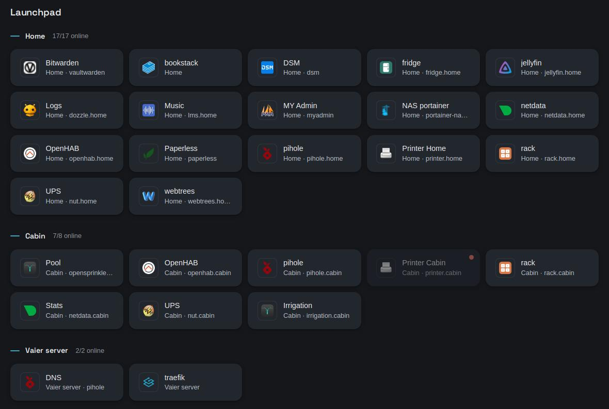
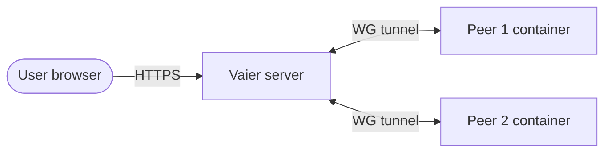

# Networking: VPN, reverse proxy, DNS, publishing

Back to [README](../README.md).



---

## How it fits together



Every published service resolves to the Vaier server through your one `*.yourdomain.com` record. Traefik terminates TLS, optionally asks for social login, and proxies the request over WireGuard to the container on a peer.

---

## Adding a VPN peer

In the **Explorer**, choose **Add machine**. It asks what you are adding and generates the rest (address, keys, config):

- **A server or PC that should join** — give it a **name**, then run the one-line setup shown in the **handoff**.
- **A phone or computer I carry** — an Android phone or Windows PC joins through the **Vaier app**. See [Enrolment from the Vaier app](#enrolment-from-the-vaier-app).
- **Something already on one of my networks** — see [LAN servers](#lan-servers-and-the-lan-scanner).

| What | Default routing | Handoff |
|------|-----------------|---------|
| A server | VPN subnet only | A **setup link**: paste one `curl -fsSL '…/vpn/peers/<id>/setup?t=<token>' \| bash` line. It runs WireGuard in a container, and asks for your password once to install Docker and the tunnel. The link is single-use and expires after about 15 minutes |
| An Android phone or Windows PC | All traffic | The Vaier app and a join code — Vaier makes no config |

The handoff turns green on the first handshake. A new server that never does usually means UDP 51820 is closed in the Vaier server's firewall. Set a server's routed LAN later from its pane; Vaier reads the network and asks only whether the fleet should reach it. A relay only passes that network on once its setup has run with it, so routing, changing or clearing a relay's LAN marks its setup out of date: **Update its setup** (or download it and run it on the relay) to finish.

Things worth knowing:

- **A full-tunnel client can't reach the LAN it is sitting on.** Its kill-switch drops that traffic. At home you don't need the tunnel for it; away, the same address works through the tunnel.
- **Setup scripts refuse to run on the wrong machine** — for example a Vaier server, or a host that would lose its own uplink. A machine is a peer *or* a LAN server, never both. Re-run with `VAIER_FORCE=1` if you truly mean it.
- **A server finds Vaier again by itself** when your Vaier server's public address changes — within a few minutes, no power cycle. A machine set up before it learned this says **its setup is out of date**: **Update its setup** once, *while the current address still works*.
- **Re-running a setup on a working machine is safe**, usually `sudo bash setup-<machine>.sh`: it finds the install wherever the machine was first set up, and leaves its files with their owner. If the run fails, it puts back the tunnel the machine had; it also carries on if the terminal you ran it from drops when the old tunnel stops. It leaves Docker's own settings alone, including an `override.conf` from `systemctl edit docker`.

### Site-to-site routing

With two or more relay peers, a machine on one site's LAN can reach a machine on another's, through both relays and the Vaier server. The far host sees the relay as the sender and needs no configuration. A LAN host that should *start* such connections needs the [LAN setup script](#lan-servers-and-the-lan-scanner).

**Adding, removing or re-addressing a relay makes every other server peer's config out of date.** Each one says so in its pane: **Update its setup**, or download it and run it there. The keypair is kept.

### Names, descriptions and status

- **Edit details** sets a machine's name and **description**. Renaming breaks nothing, and names **do not have to be unique**.
- An amber name means the machine is reachable but Vaier can't see its apps right now; its Apps pane keeps the ones it saw last. Red means unreachable.
- **Removing a machine** also forgets its SSH login and host key and stops its backups. The archives already made stay on the backup server.
- The **Map** shows one marker per site. Phones and laptops are never placed on it.

### Show-once peer config

A server peer's config is shown **exactly once**, at creation. Save what you need before closing the modal. For a fresh one, the machine's **Sign-in, details and removal** fold offers:

- **Update its setup** — keeps the keypair and puts the new setup on the machine itself. It runs at once if Vaier can become root there without a password; otherwise **Run it in ‹machine›'s shell** opens its shell with the one `sudo bash` line typed: press Enter, and **Send password** if sudo asks. The tunnel drops for a few seconds while it runs, and Vaier says when it is done: back on its new setup, or kept its old one. The setup stays out of date until the machine is on the new one.
- **Download its setup again** — the same setup as a file. Offered instead of **Update its setup** when Vaier has no sign-in for the machine, its tunnel is down, or Vaier has not checked its SSH key yet (opening its shell once does) — then run it there, or use its setup link.
- **Give it new keys**, under **Give it new keys or remove it** — rotates the keypair; the old config stops working at once. The machine keeps its address, published services, login and backups.

### Enrolment from the Vaier app

This is the only way a phone or a Windows PC joins.

1. On the device, open your Vaier and sign in, then choose **Get the Vaier app** in the menu behind your picture at the top right. It is offered only on Android and Windows. There's no store; the app already knows your Vaier's address.
2. In the app, ask to join. It shows a four-digit **join code**.
3. Approve it from **Needs you** on the fleet page, or from the mail admins receive.

At most five devices wait at once, and at most two from one internet address. A request waits ten minutes. Once approved, a device that was asleep or out of reach has a day to come back for its config. One that never does stays on the fleet page with no handshake; remove it there. The mail goes out at most once every ten minutes, so check **Needs you** for the rest.

The private key never leaves the device, so there is nothing to save.

- **Android:** add the **Vaier** tile to Quick Settings to connect without opening the app.
- **Windows:** run `VaierSetup.exe` and choose **Install**. The tunnel keeps running with the window closed. If the window says **Vaier is not running**, use **Repair**. The app is not yet signed, so SmartScreen warns on first run.
- **Leave Vaier** removes the device from the fleet. A device you remove from your end notices on its own within a few minutes.
- To remove a device, don't do it from a browser on that device — that cuts the tunnel carrying Vaier's answer. Use **Leave Vaier** instead.

### Fleet DNS

Personal devices use Vaier's **Pi-hole** for DNS, reachable only through the tunnel. Its own password is off, so publish its admin page only behind social login, never as public; only admins can open it. Through the tunnel a device reaches only that DNS and Vaier's published addresses — never the containers of Vaier's own stack directly.

### MQTT broker

Vaier runs an MQTT broker (Mosquitto). Through the tunnel every machine and phone reaches it at `10.13.13.1:1883`; another Docker stack on the Vaier server joins the external network `vaier-mqtt` and uses `mosquitto:1883`; from the internet it is at `mqtt.<your domain>:443` over TLS, published by Vaier itself. Nobody can sign in until you add a login: in **Settings → MQTT broker**, name it and press **Add login**. Vaier makes the password and shows it once — copy it then. **New password** replaces a login's password and **Remove** shuts it out; the broker takes either within a few seconds, without dropping anyone else. A login made here can read and write everything on the broker; a phone's own login (below) cannot, nor can `vaier`, the login Vaier writes its alerts to admins' phones with — leave that one alone, since Vaier puts it back.

---

### Phone positions

For home automation (openHAB and the like), the Vaier app on Android tells Vaier's MQTT broker where the phone is. There is nothing to set up: the phone reaches the broker at `10.13.13.1:1883` through the tunnel and at `mqtt.<your domain>` on 443 otherwise. Each phone gets a login of its own, named after it: a phone may only publish under its own topic and read its owner's inbox, and removing the phone removes its login. These logins appear in **Settings → MQTT broker** by the phone's name; leave them alone, since Vaier puts back any you remove or reset. A phone reports while it has an **Owner** — one of the people Vaier knows — and stops when it belongs to *Nobody*. You pick the owner when you approve the phone, set to yourself to start with, and can change it on the phone's page; that is the only thing to decide. The phone publishes under its own name — `roaming/phone/<name>/location`, `accuracy`, `wifi`, `mobile` (the carrier while off Wi-Fi), `battery` and `owner`, retained. `owner` is the owner's short name — the first word of their name, or the start of their email until they have signed in (`geir` for Geir Eilertsen) — and the phone receives house messages for them on `inbox/<owner>`. It reports a Wi-Fi change or a ten-point battery change at once, and a move of 100 m at once when moving slowly or within a kilometre of a place where it has used Wi-Fi. Faster travel elsewhere is reported at most every minute, and above about 150 km/h every 15; a move held back that way still goes out when the wait is up, and so does a vaguer position held back behind a sharper one, at the latest 10 minutes on. Nothing is sent while the phone lies still. On a Wi-Fi network it has always seen in one place, the phone reports that place, so a wrong position from Wi-Fi positioning never shows as a move; a network it has seen more than 5 km apart, like a car's, is treated as travelling. The Wi-Fi places stay on the phone. It picks the change up the next time it connects, and asks for location *all the time* the first time. Vaier itself never sees a position, nor what the houses say. An empty value is published as a cleared topic: off Wi-Fi a subscriber starting later finds no `wifi`, and on Wi-Fi no `mobile`.

## LAN servers and the LAN scanner

**LAN servers** — a NAS, printer, IPMI host, or extra Docker host on a peer's LAN — need only a LAN address.

1. In **Add a machine**, pick *Something already on one of my networks*.
2. Pick **where it is** (**At <name>**) and Vaier scans that LAN.
3. Pick a host and type a name. If it speaks SSH, attach and **test** a credential.

The scan leaves out machines already in the fleet, the Vaier server and the relays themselves among them. A relay counts once Vaier can sign in to it and has read its address. If the scan finds nothing, use **Add by address instead**. An address on a network your fleet doesn't reach yet is refused as soon as you leave the field, naming the machine whose network it is on when Vaier knows one — route that network from its page first. An address another machine already has is refused — remove or fix that one first.

Then run the machine's single-use **setup link** with `sudo`. It opens the Docker API to the fleet only and adds routes to the rest of your network. It is safe to re-run. Where Vaier can sign in there, **Run it in ‹machine›'s shell** types it in its shell for you.

A peer that is the only way to reach some LAN servers can't be removed, or have its network changed to one that leaves them out, until those LAN servers are removed.

A relay's network must be its own LAN: Vaier refuses one wider than a `/8`, one overlapping another relay's, and one overlapping the VPN's own addresses, Vaier's Docker network or the Vaier server's network, because routing any of those would cut every machine off.

For LAN servers reached from non-peer machines, see [`docs/ADVANCED.md`](ADVANCED.md).

## Devices on your networks

**Devices** (in the top bar) lists everything Vaier has seen on your home networks that is not one of your own machines — every phone, TV and gadget a relay or the house's Deco can see, and everyone on the Deco's guest Wi-Fi, which gets its own section right under its house. Who is here now comes first; tap a device to see every time it was there, kept forever. Your own machines — VPN peers, LAN servers, anything the Vaier app vouches for — are not listed there: each one's connections are under **Connections** on its own page in the fleet.

Every five minutes each relay pings its own network and reads back who answered, so a device is seen even when it ignores pings; where the house's Deco password is saved, the Deco's own list of online devices counts too, which also catches a phone whose Wi-Fi was asleep during the ping. A device on a home network is known by its hardware address; one that is away for less than 15 minutes (a phone asleep on Wi-Fi) is still counted as here.

**Names from the Deco, and the guest Wi-Fi.** These extras appear only when Vaier finds a TP-Link Deco as the house's router — it checks without signing in, and looks again about once a day if it found something else; with any other router everything else on this page works and nothing asks for a password. Give Vaier the password you use in the Deco app under **Settings → Credentials → Router passwords**, on that house's row; **Test** checks it first — the typed one, or the saved one — and says how many devices the Deco lists, without saving anything. Under a house in Devices, one quiet line leads there when no password is saved, when the Deco refuses it, or when it has failed two looks in a row; a single missed look, or a **Test** of the saved password that works, shows nothing. Nothing shows while it works. From the next look, each device shows the name the Deco gives it, and the house's guest Wi-Fi appears as its own network: the guest Wi-Fi is kept apart from the house network, so only the Deco can see it, and Vaier watches it only while it has the password. **Remove** stops Vaier reading the Deco; names it already learned stay. Vaier signs in, reads the list and signs out again each time — if you are signed in to the Deco's web page yourself at that moment, it skips that look.

**When a phone changes its address.** iPhones and Android phones use a private Wi-Fi address that can change. Vaier keeps it as one device when:
- the Deco calls the new address by the same, personal name as exactly one device it already knows on that network (a name like *iPhone* or *Galaxy* alone is not enough), and that device is not on the network under its old address; or
- the device runs the Vaier app, which tells Vaier its address on the network every time it connects or changes network.

Anything else you can join by hand: open the device, pick it under **Same device as…**, and press **Join them**. The two become one device with both histories; this cannot be split again. A device that is one of your own machines — a phone not yet on the latest Vaier app, say — you link under **This is one of my machines…** and **Link it**: it leaves Devices and its history moves to that machine's **Connections**, where **Not this machine** sends it back. A device on the house network and on its guest Wi-Fi stays two devices.

**What each device is.** Devices shows each device's maker, read off its hardware address (a phone's private address names none). About once a day, while a device on a house network is here, Vaier asks it what it answers on and reads the title of any web page it serves; opening the device shows that in one line — *Espressif · web page “Shelly 1PM” on port 80 · SSH*. Vaier asks a few devices per house per look, never your own machines, and only addresses on that house's network. The house's own Deco units are recognised — from the Deco's list of its units, or by the router's address when it gives none — named for their place (*Deco Stue*) unless you named them, and never asked or offered. Any other device that answers with a shell, Docker or a web page wears **Can join**: open it and press **Add to the fleet** to add it the way Add a machine does — you choose its name, and a sign-in if it takes shell logins — or **Not interesting** to stop the offer. A device that serves a web page also offers **Have a look**: Vaier opens its page in a new tab at `preview.<your domain>`, which only admins can open, and takes that address down 30 minutes after your last look. The very first look can take half a minute while its certificate is issued. Guest Wi-Fi devices get a maker but are not asked.

**A message when a stranger joins.** When a device Vaier has never seen joins a home network or a guest Wi-Fi, each admin's phone gets one line in the Vaier app naming it, its maker and its address. When no admin has the Vaier app, admins get one mail instead, saying for each device, what the Deco calls it, its maker, which Deco it joined through and how (Wi-Fi band or cable), its address and hardware address, when it joined, what it answers on once Vaier has asked it, and a link that opens it in Devices; several in the same round share one message. Vaier waits one look (five minutes) before telling you, so a phone that only changed its address is recognised instead. The device wears **New** until you name it or press **I know this device**. Vaier tells you about each device once, ever — naming it changes only the mark. Everything already on a network the first time Vaier looks at it counts as known and is never announced; so does every VPN peer.

Caveats:
- Only a relay Vaier can sign in to is asked, and only for a network no wider than a `/22`. The guest Wi-Fi needs the Deco password.
- A device with no personal name in the Deco and no Vaier app, that changes its address, shows up as a new device — and a new message — and can only be joined by hand.
- On some relays only root may ping; there, without the Deco password, a device that has been quiet for a while may be missed until it talks.

---

## Publishing a service

1. Start a Docker container on any connected peer.
2. In the **Explorer**, open the peer's services; the container shows under **Ready to publish**.
3. Press **Publish**, give it an address — the dialog shows the whole web address as you type — and choose **Who can open it**.
4. Vaier writes the route and waits for Traefik to accept it. There is no DNS step.

The service is live at `https://subdomain.yourdomain.com`. If Traefik refuses the route, or never loads it, Vaier removes it again.

A name too close to an existing one is refused: `printer-cabin` beside `printer.cabin`, or `/a-b` beside `/a/b` on one subdomain. So are `vaier`, `oauth2` and `dex`, which Vaier uses for its own console and sign-in. Pick another.

- Open a published service under its machine to edit it or **Unpublish** it. The container keeps running. Unpublishing a host's last service also forgets who was allowed to open it, so a service published there later starts open to every approved person.
- **Ignore** hides a row from **Ready to publish**.
- **Publish a service by hand**, at the top of a machine's services, publishes a port Vaier did not find as a container — a LAN app or a device's own web page. For it, and for a LAN container Vaier found, Vaier asks the port itself whether it speaks http or https, so it must be answering when you publish. A port that only sends the browser on to the device's own https (a camera's port 80, say) is published on that https port instead, because a browser outside could not follow it.
- On the Vaier server, only **Traefik's dashboard** and **Pi-hole's admin** are offered from Vaier's own stack. Publish them behind social login: like the console, only admins can open them, and only admins see their tiles. The MQTT broker needs no publishing; Vaier does it.

For who can open a service, see [`docs/AUTH.md`](AUTH.md).

### Multiple services on one subdomain

Set a **Path prefix** (e.g. `/auth`) to share one subdomain. The full path reaches the backend unchanged:

```
bmp.yourdomain.com         →  http://rig.yourdomain.com:8080
bmp.yourdomain.com/auth/*  →  http://rig.yourdomain.com:8090/auth/*
```

A route with a path prefix can't also send the subdomain's root elsewhere: its prefix is where it lands.

### Publishing a port that is not a website

Choose **raw TCP** instead of **website** to publish a **stream** (Vaier picks it for you on MQTT's ports): clients connect over TLS to e.g. `mqtt.example.com:443`. The port you enter is the backend port. A stream takes its whole name, so it can't share a subdomain with website routes.

**A stream cannot be put behind a login, and CrowdSec does not watch it.** Publish one only for a service whose own password you trust. If the client can't speak TLS, reach the service over the VPN at its LAN address instead.

---

## Launchpad

A public page that links to your published services, switching to LAN URLs when you're on the same network. Strangers see only public services. Signed-in users also see the social-login services they may reach; admins see all.

You can hide internal-only services. A red dot and **Not answering** under a tile mean the machine is confirmed unreachable. A signed-out visitor who can see nothing is asked to **Sign in**.

---

## Reverse proxy

Each service's **Who can open it** is *Anyone — no sign-in* or *Only people who sign in to Vaier*. When a backend is down, visitors see Vaier's **offline page**.

## Edge hardening

Traefik adds a baseline to every response:

- `nosniff` and `strict-origin-when-cross-origin` **security headers** on every service; a **frame guard** on Vaier's own pages only.
- An **edge TLS policy**: TLS 1.2 minimum, forward-secret ciphers only.
- A **rate limit** on Vaier's own public pages (the Launchpad, its icons, joining from the app): an address that keeps asking much faster than anyone browsing is told to slow down.

**CrowdSec** blocks known-malicious traffic, including addresses from its **community blocklist**, on every **published service**. Your **trusted networks** are never blocked. A first ban lasts four hours; repeat bans run longer.

The Explorer's **Security** view lists every blocked address. Each row's **…** menu offers **Lift the block** and **Trust this address**. **Block an address** bans one by hand for up to 7 days.

Trusting lifts the block and adds the address to CrowdSec's allowlist at once; **Untrust** removes it at once too. No CrowdSec restart is needed.

**If CrowdSec bans your own address**, sign in through the [recovery doors](#the-recovery-doors) and lift the block in the Security view. Your published services refuse you until you do. From the host, `docker exec crowdsec cscli decisions delete --all` clears every block.

---

### The recovery doors

`vaier.<domain>`, `oauth2.<domain>`, `dex.<domain>` and the shell gateway `shell.<domain>` are the **recovery doors**: a CrowdSec ban does not apply to them, so it can't lock you out of the console that lifts it, or out of the shell when the rest is broken. They still require sign-in and admin approval.

## Wildcard DNS

DNS is one record you make once, at your DNS host:

```
*.yourdomain.com  A  <your server's public IP>
```

That covers the console, sign-in and every service you publish. Vaier needs no DNS credentials. Vaier checks the record at boot and every five minutes until it is **covered**; until then it shows as a **pre-flight** finding under **Needs you** on the Fleet, and the row clears by itself once the record is right — no restart needed.

> **One caveat worth knowing.** Vaier publishes machine-qualified names two labels deep — `openhab.cabin.yourdomain.com`. If your zone gains a real record *under a machine label* (say an `A` record for `cabin.yourdomain.com`), `*.yourdomain.com` stops covering everything beneath `cabin` and that machine's services go dark. Keep the zone free of records under a machine label, or add a `*.cabin.yourdomain.com` wildcard alongside it.

Certificates are still issued one per hostname; the record is not a wildcard certificate. A published service whose certificate has not arrived — port 80 closed, or a Let's Encrypt limit hit — says **No certificate yet** on its row and its page, and in **Needs you**, because browsers warn before opening it.
